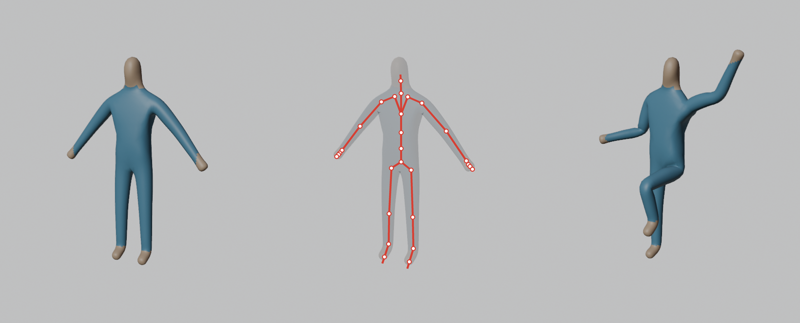

<!--
SPDX-FileCopyrightText: 2026 vikworks UG (haftungsbeschränkt)

SPDX-License-Identifier: Apache-2.0
-->

# API

giq listens on `http://localhost:8084` by default. Everything goes through
one job queue: the job API below, the OpenAI-compatible routes under `/v1`,
and the convenience endpoints for OCR and depth all submit jobs to
it. Access rules (Host/Origin checks, the optional token) are described in
[access-and-privacy.md](access-and-privacy.md).

## Submit a job

`modality` names the kind of job and `model` the recipe that serves it —
by name or alias, the same names `/recipes` lists
([ADR-003](ADR-003-domain.md) defines the terms). `worker`, the modality's
name before, is still accepted for one release.

```bash
# LLM inference
curl -X POST http://localhost:8084/run \
  -H "Content-Type: application/json" \
  -d '{
    "modality": "llm",
    "model": "gemma-4-12b",
    "tasks": [{"id": "1", "messages": [{"role": "user", "content": "Hello!"}]}]
  }'

# Image generation
curl -X POST http://localhost:8084/run \
  -H "Content-Type: application/json" \
  -d '{
    "modality": "text2image",
    "model": "zimage",
    "tasks": [{"id": "1", "prompt": "A sunset over mountains"}]
  }'
```

`/run` returns `{job_id, position}`. With `?wait=true` it blocks until the
job is done and returns the finished job instead.

## Check job status

```bash
curl http://localhost:8084/jobs/{job_id}
```

`DELETE /jobs/{job_id}` cancels a job that is still pending.

## Service status

```bash
curl http://localhost:8084/status
```

## Pause serving / free the GPU

Stops every instance — residents included — and hands the cards back. While
paused, job submission returns `503` with `Retry-After` so clients back off
instead of blocking; nothing queues up behind the pause. Also a button in the
dashboard header.

```bash
# graceful: waits up to 60s for in-flight jobs and live chat sessions
curl -X POST http://localhost:8084/control/pause -d '{"reason":"gaming"}' \
  -H 'content-type: application/json'

# need the VRAM right now — kills in-flight work
curl -X POST http://localhost:8084/control/pause -d '{"force":true}' \
  -H 'content-type: application/json'

curl -X POST http://localhost:8084/control/resume   # residents reload in ~15s
```

## Endpoints

| Endpoint | Method | Description |
|----------|--------|-------------|
| `/run` | POST | Submit a job (`?wait=true` blocks until it finishes) |
| `/jobs/{id}` | GET | Get job status and results |
| `/jobs/{id}` | DELETE | Cancel a pending job |
| `/status` | GET | Active modality, VRAM per card (`gpus`; the `vram_*` scalars are the default card's), queue depth, pause state, access posture, and the plugins: each with its source, engines, modalities, or why it was not loaded |
| `/test/{modality}` | POST | A smoke test: the modality's canned job on `?recipe=` (default: the first installed recipe serving it); a test that evicts the resident set (`text2image`) needs `?confirm=true` |
| `/gpus` | GET | Per-card telemetry; `selected` marks the default card |
| `/engines` | GET | Declared inference engines and the build each one reports |
| `/capabilities` | GET | Per modality: the recipes that run here now, preferred first (`recipes`, kept warm first), the one a request naming none runs on (`default`), what could be fetched or placed (`available`, with a one-line verdict), engines, batch ceilings and voices. Every registered modality is listed, also with nothing ready |
| `/capabilities/{modality}` | GET | One modality's entry |
| `/plugins` | GET | Installed plugins, and the curated ones that are not, each with what it adds, what it needs beyond Python, and its install command (run by the operator; the dashboard does not install plugins) |
| `/control/pause` | POST | Stop serving, unload everything, free VRAM |
| `/control/resume` | POST | Resume serving; residents reload |
| `/stats/summary`, `/stats/timeline`, `/stats/usage`, `/stats/jobs` | GET | Job history (see [Privacy](access-and-privacy.md#privacy) for what is recorded) |
| `/stats/gpus`, `/stats/vram`, `/stats/gpus/eras` | GET | GPU telemetry history and per-card job totals |
| `/storage` | GET | Per-mount disk usage, the resolved directories and the operator's recipe files — see [Storage](#storage) |
| `/recipes` | GET | Every recipe: modalities, engine, installed, availability (`ready`, `fetchable`, `manual`, `unfit`) with the checks behind it, residency, card, fit, the instance running it, weights ids; per-card pinned budgets; reload order |
| `/recipes/{name}` | GET | One recipe, by name or alias |
| `/recipes/{name}/plan` | GET | What fetching it takes: this machine's checks plus, from the Hugging Face Hub, the download size, gated access and licence; the transfers a fetch would make, and the `giq add` command |
| `/recipes/{name}/fetch` | POST | Fetch its missing weights (202, the download); 409 when it is already here, when the plan fails, or when the service may not write where the files go (the detail carries the `giq add` command) |
| `/recipes/{name}/weights` | DELETE | Delete its weights, except those another recipe also loads (`kept`); refused while it is resident or loaded |
| `/downloads` | GET | Every fetch since the service started: state, bytes done and total, the repository being fetched, the error |
| `/downloads/{id}` | GET, DELETE | One fetch; DELETE cancels it, keeping what arrived so the next fetch resumes |
| `/recipes/{name}/residency` | PUT, DELETE | `{"policy": "pinned" \| "auto" \| "off", "reason"?, "force"?}`; DELETE returns to the default |
| `/recipes/{name}/card` | PUT | `{"device": index \| uuid \| null, "force"?}` — bind to a card, or unbind |
| `/instances` | GET | Every recipe running on a card: residency (`resident`/`on_demand`), state, card, port, pid, lanes, VRAM |
| `/weights` | GET | Every checkpoint the recipes name, once each: location, provenance, the recipes that load it, size — see [Weights](#weights) |
| `/weights/{id}` | DELETE | Delete one checkpoint; the recipes using it stay, uninstalled |
| `/v1/chat/completions` | POST | OpenAI-compatible chat, streaming and tool calls included |
| `/v1/responses` | POST | OpenAI Responses API, streaming and tool calls included — see [Responses API](#responses-api) |
| `/v1/models` | GET | The chat recipes that run here (weights on disk, an engine, a card they fit, not switched off), kept warm first |
| `/v1/audio/transcriptions` | POST | Speech to text with speaker diarization (faster-whisper + pyannote; `?diarize=false` skips it); `model` names the recipe, and a name that is no recipe (OpenAI's `whisper-1`) gets whisper-large-v3 |
| `/v1/audio/speech` | POST | Text to speech; `model` as above, defaulting to kokoro |
| `/v1/audio/embeddings` | POST | Speaker voiceprint of an audio clip; `model` as above, defaulting to ecapa-tdnn |
| `/dash` | GET | Dashboard (overview, recipes, inventory, usage, sandbox; English/German; light/dark/system theme) |
| `/ocr` | POST | One PDF (multipart `file`) in, one HTML document out — see [OCR](#ocr) |
| `/depth` | POST | One image in, one 16-bit depth map out — see [Depth](#depth) |
| `/decide` | POST | A record plus 0-2 images and typed questions in, calibrated probabilities out — see [Decide](#decide) |

## Modalities

### LLM (`llm`)
- Recipes: every recipe file serving `llm` (`giq/recipes/<name>.yaml` and
  your own, see [Recipes](configuration.md#recipes)) — GGUFs via llama.cpp,
  Hugging Face checkpoints via vllm; `/capabilities` lists them
- Task: `{id, messages[], temperature?, max_tokens?}`
- Result: `{id, text}`

A non-streaming request waits for its recipe's instance to start and then
for its answer: the start budget (the recipe's `ready_timeout`, or the
engine's default — minutes for vllm) plus the job's time limit. A cold recipe
therefore answers late rather than with a 504. Streaming requests send
keepalives while the instance starts.

#### Responses API

`/v1/responses` speaks the OpenAI Responses interface — `input` plus
`instructions` in, a `response` object out, or the typed `response.*` SSE
event stream when `stream: true`. giq's engines speak Chat Completions, so this
is a translation rather than a proxy: `input` (a string or a list of
`message` / `function_call` / `function_call_output` items) and `instructions`
fold into a chat message list, `max_output_tokens` maps to `max_tokens`,
`tools` are renested, and `text.format` carries a JSON schema through to the
engine. Tool calls, reasoning and images work as they do on
`/v1/chat/completions`. A `developer` message joins the system prompt, which
is what the chat templates behind giq call it.

Thinking is controlled as on the chat path: `chat_template_kwargs` passes
through, and `reasoning.effort: "none"` or `"minimal"` turns thinking off
(the engines switch thinking rather than grade it, so the other levels leave
the model's default). The top-level `reasoning_budget_tokens` caps the
thought. The model's thinking comes back as a `reasoning` item whose
`content` holds the raw thought as `reasoning_text` — streamed as
`response.reasoning_text.delta` — rather than as a `summary`, which giq has
none of.

giq keeps no server-side conversation store, so `previous_response_id` and
stored responses are unavailable. A request that sets `previous_response_id`
or `store: true` is refused with 400; omitted `store` and `store: false` run
statelessly. Resend the prior turns in `input` to continue a conversation.
For the same reason there is no file store: an `input_image` that names a
`file_id`, or an `input_file` of any kind, is refused with 400 rather than
dropped — send the image inline as an `image_url` data URI. Only your own
function tools run: the tools OpenAI hosts (web search, file search, code
interpreter, MCP, image generation, computer use) are refused with 400 instead
of being accepted and never used. `tool_choice` takes the modes, a forced
function, or `allowed_tools` over those functions.

Responses streams end with their typed `response.completed`,
`response.incomplete`, or `response.failed` event, without the Chat Completions
`[DONE]` sentinel. A generation stopped by `max_output_tokens` returns
`status: incomplete` and `incomplete_details.reason: max_output_tokens`. A
generation cut short — the client stopped reading, or the job was cancelled —
ends as `response.failed` with error code `giq_stream_cancelled`, carrying
whatever was produced as incomplete items; a job that failed before or during
generation ends as `response.failed` with `giq_job_failed`.

### Text2Image (`text2image`)
- Recipes: `flux_klein` (FLUX.2 klein 4B, sd.cpp), `zimage` (Z-Image-Turbo,
  sd.cpp)
- Task: `{id, prompt, negative_prompt?, seed?, width?, height?}`
- Result: `{id, image_b64, seed}`
- Size: `width` and `height` go together, on the task or in the job's
  `params`. A task's pair wins over the params' pair, and the two are never
  mixed. Without a pair the configured `image_generation` size is used as is.
  A requested size is held to at least 256 px a side and at most the
  recipe's `params.max_render_pixels`, keeping the aspect ratio, then
  snapped down to multiples of 16: 1000x750 renders at 992x736. The budgets
  are measured: 2.4 MP (2048x1152) for `flux_klein`, `zimage` and
  `qwen-image-edit-2511`. A lone side or a non-numeric size falls
  back to the default. Renders larger than the default decode the VAE in tiles.

### Image Edit (`image_edit`)
- Recipes: `flux_klein` (reference edits via sd.cpp), `qwen-image-edit-2511`
  (Qwen-Image-Edit-2511 with the 4-step Lightning LoRA, sd.cpp)
- Task: `{id, reference_image_b64, instruction, negative_prompt?, width?,
  height?, seed?, loras?}` (size as for text2image)
- Result: `{id, image_b64, seed}`
- `loras` switches on LoRAs the recipe carries for the tasks that want them,
  by name, beside the one it applies to every render. A name the recipe does
  not have fails the task. `qwen-image-edit-2511` has `camera`:
  [fal's multiple-angles LoRA](https://huggingface.co/fal/Qwen-Image-Edit-2511-Multiple-Angles-LoRA)
  (Apache-2.0), which redraws the reference from another camera position.
  With it the instruction is the position and nothing else: `<sks>`, then an
  azimuth (`front view`, `front-right quarter view`, `right side view`,
  `back-right quarter view`, `back view`, `back-left quarter view`,
  `left side view`, `front-left quarter view`), an elevation (`low-angle
  shot`, `eye-level shot`, `elevated shot`, `high-angle shot`) and a
  distance (`close-up`, `medium shot`, `wide shot`).
- The LoRA decides what an object's front is, and the reference's own angle
  shows through: from a three-quarter picture, a "side view" comes back
  nearer three-quarter than side-on. Where the views have to be exact, check
  them before relying on them.

```bash
jq -n --rawfile img <(base64 -w0 crate.png) '{modality:"image_edit",
  model:"qwen-image-edit-2511", tasks:[{id:"1", reference_image_b64:$img,
  instruction:"<sks> back view eye-level shot medium shot", loras:["camera"]}]}' \
  | curl -s -X POST 'localhost:8084/run?wait=true' -H 'Content-Type: application/json' -d @- \
  | jq -r '.results[0].image_b64' | base64 -d > crate-back.png
```

### OCR (`ocr`)
- Recipes: `unlimited-ocr` (baidu, 3B, one pass over many pages),
  `glm-ocr` (zai-org 0.9B behind PP-DocLayoutV3: layout, then each region
  read with the prompt for its kind — the stronger choice for tables)
- Task: `{id, pdf_b64 | images_b64[], dpi?, pages?, raw?, strip?, merge?}`
- Result: `{id, html, pages, blocks[], raw?, tokens_in, tokens_out, truncated}`

### Depth (`depth`)
- Recipes: `depth-anything-v2-small` (Apache-2.0, the default; Base and Large
  are CC-BY-NC-4.0 and not registered)
- Task: `{id, image_b64, visualize?}`
- Result: `{id, depth_b64, width, height, depth_min, depth_max, metric, visualization_b64?}`

### Text2Music (`text2music`)
- Recipes: `ace-step-1.5-turbo` (ACE-Step 1.5, MIT: a 2B DiT planned by a
  1.7B LM; 48 kHz stereo, 10 s to 10 min, lyrics in 50+ languages, 8
  steps); `ace-step-1.5-xl-sft` (the 4B DiT, 50 steps with guidance: the
  closest to a prompt's genre, and slower); `ace-step-1.5-xl-base` (the 4B
  base DiT, which also adds tracks to audio of your own)
- Task: `{id, prompt, lyrics?, instrumental?, duration?, bpm?, key_scale?,
  time_signature?, language?, seed?, plan?, format?, reference_audio_b64?,
  source_audio_b64?, mode?, cover_strength?, track?, tracks?}`
- Result: `{id, audio_b64, format, sample_rate, duration, seed, bpm,
  key_scale, time_signature, caption, lyrics}`
- `prompt` describes the music (genre, instruments, mood). `lyrics` uses
  section tags (`[verse]`, `[chorus]` …); without lyrics the track is an
  instrumental unless `instrumental` says otherwise. `plan` (default on)
  lets the planner fill in what the task leaves open — `duration` (10-600 s),
  `bpm` (30-300), `key_scale` (`"A minor"`), `time_signature` (`2/4`, `3/4`,
  `4/4`, `6/8`) — and enrich a short prompt; the result reports what the
  track got, the task's values where it gave them. Unplanned, a task without
  a `duration` renders 30 s. `seed` makes a track reproducible; without one
  the result carries the seed it got. `format`: `flac` (default), `wav`,
  `mp3`.
- A task may bring audio of its own, base64 WAV, FLAC, Ogg or MP3.
  `reference_audio_b64` lends the track its sound — timbre, mix, playing
  style — but not its melody or rhythm; the planner still runs.
  `source_audio_b64` is what the track is built from, by `mode`:
  - `cover` (the default): the source's structure, melody and groove in the
    prompt's style. `cover_strength` (0-1, default 0.5) is how closely it
    follows; ACE-Step's guide puts a change of genre at 0.3-0.5.
  - `lego`: the source stays, and the model plays one `track` over it —
    `guitar`, `bass`, `drums`, `keyboard`, `synth`, `strings`, `brass`,
    `woodwinds`, `percussion`, `vocals`, `backing_vocals`, `fx`.
  - `complete`: the source stays, and the model fills in what it lacks, or
    the `tracks` listed.

  With source audio the planner sits out and the source's length is the
  track's. Which modes a recipe does is its `tasks` parameter: every
  ACE-Step recipe covers, and lego and complete need `ace-step-1.5-xl-base`.

```bash
curl -s -X POST 'localhost:8084/run?wait=true' -H 'Content-Type: application/json' \
  -d '{"modality":"text2music","model":"ace-step-1.5-turbo",
       "tasks":[{"id":"1","prompt":"warm lo-fi hip hop, mellow Rhodes piano","duration":60}]}' \
  | jq -r '.results[0].audio_b64' | base64 -d > track.flac
```

A guitar over a drum beat of your own:

```bash
jq -n --rawfile beat <(base64 -w0 beat.wav) '{modality:"text2music",
  model:"ace-step-1.5-xl-base", tasks:[{id:"1", source_audio_b64:$beat,
  mode:"lego", track:"guitar",
  prompt:"thrash metal, down-tuned distorted rhythm guitar, palm-muted riffs"}]}' \
  | curl -s -X POST 'localhost:8084/run?wait=true' -H 'Content-Type: application/json' -d @- \
  | jq -r '.results[0].audio_b64' | base64 -d > with-guitar.flac
```


### Image2Mesh (`image2mesh`)
- Recipes: `pixal3d` (Pixal3D, MIT: one image to a textured mesh with PBR
  materials, posed as the picture and close to it), `trellis2` (Microsoft's
  TRELLIS.2, MIT: one image to a mesh standing upright in a frame of its
  own, freer with the surface), `trellis2-parts` (the same with a part
  segmenter beside it: an asset whole, or cut into its parts) and
  `pixal3d-mv` (Pixal3D's multi-view checkpoints: four views to a mesh);
  from the `giq-3d` plugin, which `giq-defaults` does not install
- Task: `{id, image_b64 | views_b64[4], mode?, faces?, texture_size?, close?,
  shell?, seed?, fov?, parts?, part_seeds?}`
- Result: `{id, glb_b64, format, mode, faces, vertices, texture_size, seed,
  parts?, contacts?}`
- `image_b64` is one picture of the object: PNG, JPEG or WebP, a data URL
  prefix allowed. With an alpha channel the object is what is opaque; without
  one the background is removed first. One object, all of it in frame, on a
  plain background works best. The mesh comes out posed the way the picture
  was taken: drawn from above, it leans toward the viewer. `trellis2` takes
  the same task, less `fov`, and gives the object upright and squared to the
  axes whatever the picture's angle.
- `pixal3d-mv` takes `views_b64` in its place: four images a quarter turn
  apart round the object, in the order front, right side, back, left side,
  each level with the object. They need not match in size or framing: every
  view is cut out and scaled so the object has one height in all four,
  which is what puts them at one camera distance. The mesh comes out upright
  and squared to the axes, with the sides as the views show them. Views that
  disagree about the object give doubled or smeared geometry, so look at
  them first. `fov` does not apply.
- `mode` picks the export. `game` (default) is a low-poly asset: a closed
  cage of `faces` triangles (200-50,000, default 3,000) rebuilt from the
  outside of the generated mesh, so no face is spent where nobody can see,
  with base colour, metallic-roughness and a tangent-space normal map baked
  onto it from the full mesh. `close` (0-8, default 4) is how wide an opening
  may be, in voxels of the cage's 384 grid, and still be closed in the cage:
  vent slots become colour and normal map, a carry handle stays open; 0
  closes nothing. `shell` (0-2, default 0) keeps that many voxels round the
  surface solid whatever can be seen through it: 1 is for an asset with thin
  panels seen from both sides, the plaster of a half-timbered wall, which
  the cage would otherwise lose. `full` is Pixal3D's own export, the generated mesh
  simplified to `faces` (5,000-1,000,000, default 100,000), without a normal
  map.
- `texture_size`: 1024, 2048 (default for `game`) or 4096 (default for
  `full`). `seed` (default 42) makes an asset reproducible. `fov` is the
  camera's horizontal field of view in radians; without it the camera is
  estimated from the image.
- `parts: true` (`trellis2-parts` only, `game` exports only) cuts the asset
  into the rigid pieces it is made of: a chest comes back as a box and a
  lid, an excavator as cab, chassis, track belts, arm and bucket. The GLB
  then holds one mesh a piece, named `part_0` (the largest) onward, each a
  closed low-poly cage of its own with its own textures, all in the asset's
  frame; `faces` is the total, shared out by each piece's share of the
  surface, with at least 500 a piece. The result adds `parts`, a
  `{name, faces, vertices, share}` per piece, and `contacts`, a
  `{parts: [a, b], points, centre}` for every two pieces that touch: how
  many vertices of the generated mesh they share and the middle of those,
  in the GLB's coordinates. Nothing says what turns on what: a hinge or a
  turntable is the caller's to place, and a contact is where to look. The
  cut is drawn by a sampling model and differs from one drawing to the
  next, so it is drawn `part_seeds` times (1-6, default 3) and the drawings
  are laid over one another; more seeds find more cuts, at about 10 s each.
  At most eight pieces are kept. An asset the model sees as one piece comes
  back as one.
- The GLB is glTF 2.0 with WebP textures (`EXT_texture_webp`), Y up. A
  `game` asset at 3,000 faces is about 1 MB, a `full` one at 100,000 about
  8 MB.

```bash
jq -n --rawfile img <(base64 -w0 cannon.png) '{modality:"image2mesh",
  model:"pixal3d", tasks:[{id:"1", image_b64:$img, faces:1500}]}' \
  | curl -s -X POST 'localhost:8084/run?wait=true' -H 'Content-Type: application/json' -d @- \
  | jq -r '.results[0].glb_b64' | base64 -d > cannon.glb
```

### Mesh2Rig (`mesh2rig`)
- Recipes: `skintokens` (SkinTokens, MIT: a mesh to a skeleton and its skin
  weights, generated as one sequence); from the `giq-rig` plugin, which
  `giq-defaults` does not install



*A figure modelled for this picture, rigged by `skintokens` with the default seed: the mesh as sent, the 28 bones it came back with, and a pose set on those bones in Blender afterwards.*

- Task: `{id, glb_b64, seed?, keep_skeleton?, voxel_skin?, num_beams?,
  temperature?, top_k?, top_p?, repetition_penalty?}`
- Result: `{id, glb_b64, format, bones, seed}`
- `glb_b64` is the mesh as binary glTF (GLB), base64, a data URL prefix
  allowed, up to 64 MB. A character or creature standing in its rest pose
  works best, an A- or T-pose for a humanoid: rigged game and VRoid
  characters and rigged Objaverse models are what the model learnt from.
  A GLB from `image2mesh` goes in as it comes out.
- What comes back is the same GLB — its meshes, materials, textures, scale
  and placement as given — bound to one armature: bones named `bone_0`
  onward, each vertex weighted to at most four of them. How many bones a
  mesh gets is the model's choice, and differs from mesh to mesh and from
  seed to seed; `bones` says how many this one got. There is no animation:
  the rest pose is the mesh's own.
- `seed` (default 42) seeds the sampler, and another seed draws another
  skeleton. The same seed on the same card draws the same skeleton again;
  its skin weights come back within a few hundredths, not to the bit, and
  another card can draw another skeleton for it. The sampler is a beam
  search with sampling, and its settings are upstream's, with their
  defaults: `num_beams` (1-20, default 10; fewer is faster), `temperature`
  (0.1-2.0, default 1.0), `top_k` (1-200, default 5), `top_p` (0.1-1.0,
  default 0.95), `repetition_penalty` (0.5-3.0, default 2.0).
- `keep_skeleton: true` skins a GLB to the armature it already has: its
  bones stay, and only the weights are generated. A GLB without one fails
  the task.
- `voxel_skin: true` trims the weight a bone has on parts of the mesh that
  do not touch the part it sits in, a hand's weight on the thigh it hangs
  beside.

```bash
jq -n --rawfile mesh <(base64 -w0 hero.glb) '{modality:"mesh2rig",
  model:"skintokens", tasks:[{id:"1", glb_b64:$mesh}]}' \
  | curl -s -X POST 'localhost:8084/run?wait=true' -H 'Content-Type: application/json' -d @- \
  | jq -r '.results[0].glb_b64' | base64 -d > hero-rigged.glb
```

### Audio, voiceprints, speech

The resident audio stack (`whisper-large-v3`: faster-whisper plus pyannote
diarization), speaker voiceprints (`ecapa-tdnn`) and text to speech
(`kokoro`) are reached through the `/v1/audio/*` routes above. Plain speech
to text without diarization (`stt`: `faster-whisper-tiny` …
`faster-whisper-large-v3`; the bare sizes still work as aliases) is a batch
modality behind `/run`. `/capabilities` lists every modality's recipes, and
Kokoro's voices. A `/v1/audio/*` request whose `model` is no recipe (OpenAI's
`whisper-1`, `tts-1`) runs on the modality's `default`, or on the recipe named
above when nothing is ready yet; its child fetches the weights on first load.

## OCR

PDF or page images in, a document out: layout-tagged text from
baidu/Unlimited-OCR, then page furniture (running headers, footers, page
numbers) dropped and a table or paragraph the page break cut in two
re-joined, rendered as an HTML fragment. Every element carries
`data-page` and `data-bbox` (0-999 page coordinates), tables pass through
as the model wrote them, everything else is escaped.

```bash
# the convenience form: the PDF is the body, options are query parameters
curl -s --data-binary @statement.pdf -H 'content-type: application/pdf' \
  'http://localhost:8084/ocr?model=glm-ocr&dpi=200' | jq -r .html
curl -s -F file=@statement.pdf 'http://localhost:8084/ocr?response_format=html'

# the generic form, for a consumer that already speaks /run
curl -X POST http://localhost:8084/run -H 'content-type: application/json' \
  -d '{"modality":"ocr","model":"unlimited-ocr",
       "tasks":[{"id":"1","pdf_b64":"...","dpi":200}]}'
```

Query parameters: `model` (`unlimited-ocr`, the default, or `glm-ocr`),
`dpi` (50-400, default 200), `pages` (`1-3,7`; default all), `strip=false` keeps the furniture, `merge=false` keeps page breaks,
`raw=true` adds the model's own tagged text, `response_format=html` returns
the fragment. Multipart is accepted for clients that only speak that; the
`file` part is the document and the filename is never read.

What is kept, and where. The document and its result live in memory only:
the upload is buffered in RAM (never spooled to `/tmp`, whatever its size),
the child rasterizes one pass of pages at a time and writes nothing, and the
finished job leaves the in-memory job store five minutes after completion.
The stats row records tokens in and out, timings and the GPU; the in-flight
log counts a PDF as one attachment; neither has a column a filename or a
line of text could go in. Two limits bound the RAM: `GIQ_OCR_MAX_UPLOAD_MB`
(default 64, the most a base64 task can be and still fit the parent→child
pipe; over it is a 413) and `GIQ_OCR_MAX_PAGES` (default 200, refused before
rendering). Both models run from local snapshots pinned to reviewed
revisions with the Hugging Face hub disabled in the child process, both on
giq's own transformers; neither
engine touches the network (verified with strace), and zai-org's own
`glmocr` SDK is not used because it defaults to forwarding documents to
Zhipu's cloud API. Unlimited-OCR: ~80 tokens/s, a dozen pages in one pass,
longer documents in consecutive passes. GLM-OCR: ~100 tokens/s, a four-page
invoice in 16 s including layout, 3.2 GB peak (on an RTX 5090).

## Depth

One RGB image in, one depth map out at the image's own resolution, through
Depth Anything V2 (DINOv2 encoder, DPT head; native transformers, local
snapshots, hub disabled in the child).

```bash
curl -s -H 'Content-Type: image/jpeg' --data-binary @photo.jpg \
  'http://localhost:8084/depth' | jq '{width, height, depth_min, depth_max}'
curl -s -F file=@photo.jpg 'http://localhost:8084/depth?response_format=png' > depth16.png
curl -s -F file=@photo.jpg 'http://localhost:8084/depth?response_format=visualization' > depth.png
# or through the job API, several images per job:
curl -s -X POST localhost:8084/run?wait=true -H 'Content-Type: application/json' \
  -d '{"modality":"depth","model":"depth-anything-v2-small",
       "tasks":[{"id":"1","image_b64":"...","visualize":true}]}'
```

Query parameters: `model` (`depth-anything-v2-small`, the default and only
registered one), `visualize` (add a colour-mapped PNG, near red,
far blue), `response_format` (`json`, `png` for the 16-bit map itself,
`visualization` for the coloured one). PNG, JPEG and WebP in, as the body or
a multipart `file`; anything else is a 400 before it costs a job, and the
upload cap is the same `GIQ_OCR_MAX_UPLOAD_MB`.

What the map means: the model predicts **relative inverse depth** — larger
is nearer, no unit, an unknown scale and shift per image. The 16-bit PNG
spans `depth_min..depth_max` of that prediction linearly, so the model's own
values are `depth_min + png / 65535 * (depth_max - depth_min)`; `metric` is
false. That is what a ControlNet, a parallax effect or a relighting pass
wants; anything that needs metres wants a metric checkpoint (Depth Anything
V2 has indoor/outdoor ones; not registered yet).

Why not Marigold V2: it is a LoRA on
Qwen-Image-Edit-2509, a 20B diffusion transformer — 17 GB of VRAM at 1024²,
~40 GiB of weights, and a diffusers/bitsandbytes/peft stack giq does not
carry. It is sharper on hair and foliage edges and the paper puts it ahead of
Depth Anything V2 on the benchmarks (3.6 vs 4.5% AbsRel on NYUv2), but it
would evict the residents on every call where this one loads in 3 s and
sits beside them. Small: 1.2 GB peak, measured on an RTX 5090 with a
1280x2276 photo; it answers in under a second including the PNG encode.
Licences are part of the choice: only Small is Apache-2.0, so Base and Large
(CC-BY-NC-4.0, non-commercial) are not registered.

## Decide

A record plus 0-2 photos and 1-8 typed questions in, calibrated
probabilities out, through imajev-2b (Qwen3.5-2B plus a rank-16 LoRA and a
255-code decision readout; Apache-2.0): typed questions (`choice`,
`noul` for yes/no, `score`, `multi`) over your own record, in the request
and response shapes of TypeSafe's Jev API plus images (imajev is an
independent model, not affiliated with Jev). Each answer comes with a
probability per option plus `unknown_probability` (the trained *can't tell*)
and `abstained`. Act above a threshold you measured on your own cases; send
abstentions and low-confidence answers to a person.

```bash
curl -s -X POST localhost:8084/decide -H 'Content-Type: application/json' \
  -d '{"state": "Ticket: charged twice for one order.",
       "questions": {"queue": {"type": "choice", "instructions": "Route the ticket.",
                               "criteria": {"billing": null, "shipping": null}}}},
       "rotations": 1}'
curl -s -F request='{"state": {"listing": {"color": "red"}},
                      "questions": {"wrong_field": {"type": "choice",
                        "instructions": "Which listing field does the photo contradict?",
                        "criteria": {"listing.color": null, "none": null}}}}' \
     -F image0=@photo.jpg localhost:8084/decide
# or through the job API, up to max_batch tasks per job:
curl -s -X POST localhost:8084/run?wait=true -H 'Content-Type: application/json' \
  -d '{"modality":"decide","model":"imajev-2b",
       "tasks":[{"id":"1","state": {...},"questions": {...},"rotations": 1}]}'
```

Query parameters: `model` (`imajev-2b`, the default and only registered one).
`rotations` (1-4, default 1; 4 averages four option orders, about 3x the latency)
and `calibration` (artifact name, default `calibration.json`) ride in the
payload. Limits: 128 KB state, 4096 tokens, 0-2 images (JPEG/PNG/WebP, 20 MB
and 20 Mpixel each). Sleepy model: loads on demand, evictable; 5.0 GB
(4.5 GiB measured at the card, CUDA context included).

## Weights

`GET /weights` lists every checkpoint the recipes name — a file or
directory on disk, or a Hugging Face repository in the cache — once, however
many recipes load it ([ADR-003](ADR-003-domain.md)). A recipe's parts (an
image model's diffusion model, text encoder and VAE) are checkpoints too.

```json
{"weights": [
  {"id": "07bc6fc2f4f1", "path": null, "repo": "Systran/faster-whisper-large-v3",
   "format": null, "source": "hf:Systran/faster-whisper-large-v3", "revision": null,
   "licence": null, "recipes": ["faster-whisper-large-v3", "whisper-large-v3"],
   "used_by": ["faster-whisper-large-v3", "whisper-large-v3:asr"],
   "on_disk": true, "size_bytes": 6181672394, "mount": "/"}
]}
```

`id` is a hash of the location: stable while the files stay where they are.
A part with no licence of its own carries its recipe's. `DELETE
/weights/{id}` removes the files and is refused with 409 while a recipe that
uses them is resident or loaded; the recipes stay in the catalog, not
installed. Two recipes that name the same files must agree on their format,
source, revision and licence — a recipe file that contradicts another is
left out, like any other broken one.

## Storage

`GET /storage` answers how full the disks are and where giq looks; what is
on them, checkpoint by checkpoint, is [`/weights`](#weights):

- `disks` — per mount: total, free, how much of it is weights (each file
  counted once), and the rest.
- `paths` — every data directory giq resolved (config, models, recipes,
  engines, state, caches).
- `recipes` — the operator's [recipe files](configuration.md#recipes):

```json
"recipes": {
  "dir": "/home/me/.config/giq/recipes",
  "builtin_dir": "/opt/giq/src/giq/recipes",
  "files": [
    {"file": "/home/me/.config/giq/recipes/gemma.yaml", "name": "gemma-4-12b",
     "modalities": ["llm"], "replaces_builtin": true}
  ],
  "overrides": ["gemma-4-12b"],
  "errors": [
    {"file": "/home/me/.config/giq/recipes/broken.yaml",
     "message": "params.ctx: Extra inputs are not permitted"}
  ]
}
```

`files` are the operator files serving; `overrides` the built-ins they
replace; `errors` the files left out, each with giq's reason (`file` is
`null` when the problem is not one file's, such as two files defining one
recipe). A file in `errors` is not served — a built-in of that name keeps
serving — until it is fixed and giq restarted.

## Vision

Recipes that declare the `vision` capability accept images alongside text, via
llama.cpp's `--mmproj` projector. Send OpenAI-style content parts to
`/v1/chat/completions`:

```json
{"model": "...", "messages": [{"role": "user", "content": [
  {"type": "text", "text": "What is in this image?"},
  {"type": "image_url", "image_url": {"url": "data:image/png;base64,..."}}]}]}
```

Requests carrying images are forwarded to llama-server intact. Aiming one at a
model without vision returns 400 rather than silently dropping the image. The
dashboard's sandbox has an **image + question** panel for it.

## Structured output

`/v1/chat/completions` forwards two constrained-decoding controls to the
engine, and takes one of them per request:

- `response_format` — the OpenAI spelling, `{"type": "json_object"}` or
  `{"type": "json_schema", "json_schema": {...}}`. Honoured by llama.cpp
  (GBNF) and vllm alike, and the portable choice. On `/v1/responses` the same
  thing arrives as `text.format`.
- `structured_outputs` — vllm's native knob (`json`, `regex`, `choice`,
  `grammar`), enforced at decode time. llama-server ignores it.

Sending both in one request is refused with 400: vllm folds `response_format`
into its own constraint set and then rejects the merged pair as mutually
exclusive, so the conflict is reported at the API edge instead of surfacing as
an opaque engine error.
